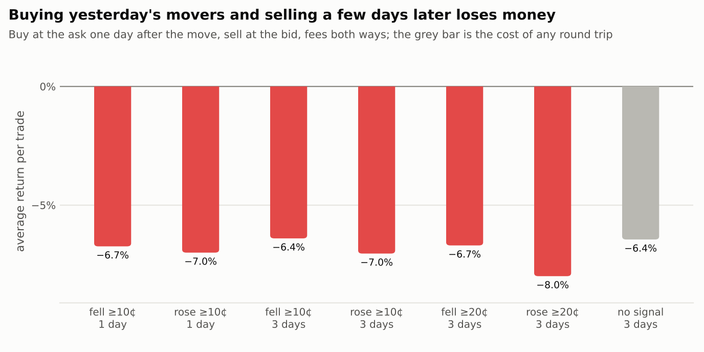
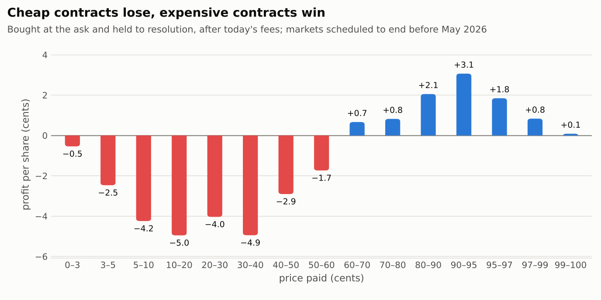
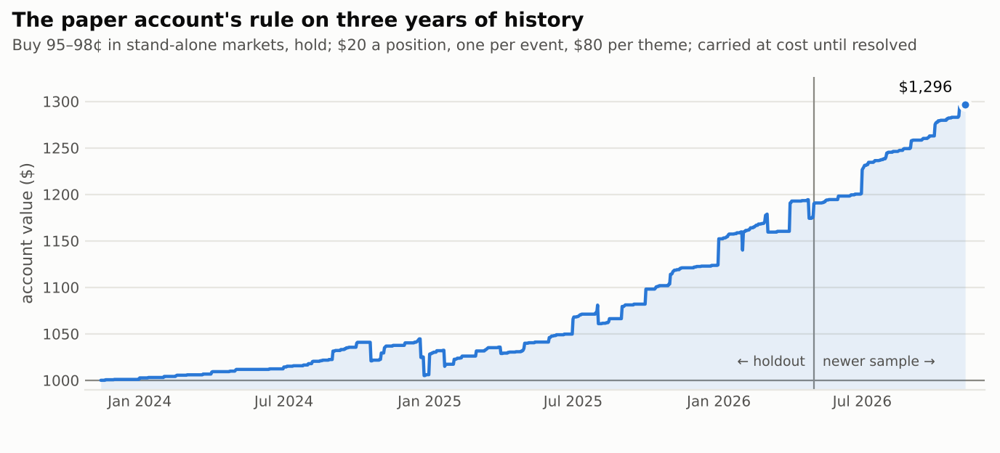

# 02 — Research findings

*Written 2026-11-10 after the tests fixed in `01_thinking_session.md` were
run. Every number here comes from a table in `reports/research/`; the script
that produced each one is named alongside it.*

## The short version

1. **The original idea, taken literally, does not make money.** Buying a
   contract because the crowd's price is expected to move, and selling it a
   few days later, lost about 6–7% per trade in every form tested. Prices on
   Polymarket move almost unpredictably from day to day, and a round trip
   costs about 6% of the stake at mid-range prices (2.5% where there is no
   fee). Sports prices before a game do not drift the way the Seahawks
   example imagines.
2. **The crowd does have a standing blind spot.** In non-sports markets,
   cheap contracts are badly overpriced: one bought for under 10¢ loses about
   60% of the stake on average. The mirror image is that near-certain
   contracts are slightly too cheap.
3. **The rule I committed to in advance failed its test; one of its
   pre-registered variants passed.** Buying 90–97¢ contracts and holding them:
   +0.88% per trade on unseen data, t = 1.7 — not enough. Buying 95–99¢
   contracts: +0.96% per trade, t = 3.6 over 2,822 trades. The longshot
   control lost 37% per trade, as predicted.
4. **What the paper account trades** is that variant, narrowed to where the
   evidence is: 95–98¢ contracts in stand-alone yes/no markets, bought a day
   after they are first seen in that range, held to resolution. About 98 in
   100 such trades gain 3–4%; about 2 in 100 lose everything staked.
5. **It is a small edge.** Run as a $1,000 account at $20 a position, the
   backtest made roughly 7–9% a year with a third of the money in use. It is
   real enough to keep testing and too thin to be excited about.
6. **Sports: nothing.** Both sports rules failed. Pre-game sports prices on
   Polymarket are well calibrated.

## 1. The data

All from Polymarket's public APIs; no account was needed.

| | |
|---|---|
| Resolved markets with at least 100,000 shares traded | 114,972 |
| Trade-by-trade tapes, non-sports and non-crypto markets | 16,335 markets, 59.3 million trades, Nov 2023 – Nov 2026 |
| Trade-by-trade tapes, sports game-winner markets | 32,410 games, 21.2 million pre-game trades |
| Quoted price histories (12-hour bars; 3-hour bars from July 2026) | 69,053 markets |

Two decisions about how to use it mattered more than any model.

**Which markets count.** A market is used only from the moment it has already
traded 100,000 shares. That is something a trader could have known at the
time. Section 2 shows what happens without this rule.

**What price counts.** Polymarket keeps no history of order books, but every
trade on the tape records which side was the taker. The last taker *buy* of an
outcome printed at about its ask, the last taker *sell* at about its bid. So
the backtests buy at a price somebody demonstrably paid, one day after the
signal, and pay today's fee for the market's category
(`src/kht/research/quotes.py`, `src/kht/backtest/harvest.py`).

## 2. The sample that lied

My first pass selected markets by their *total* volume and used quoted
mid-prices. It produced two confident findings.

| First pass (`reports/research/first_pass_biased/`) | Result | |
|---|---|---|
| Sports favourites are overpriced | calibration slope 0.83 | t = −6.1 |
| Yesterday's move partly reverses | slope −0.03 to −0.08 | t = −5 to −8 |

Both were wrong, for different reasons.

Total volume includes trading *during* the game, and a game with a comeback or
an upset trades far more. Selecting on it quietly over-samples upsets. In the
first games I checked, the slope was 0.52 where little had traded before
kick-off and 1.17 where a lot had. With the no-hindsight rule the sports slope
is 0.97 (t = −0.8, 4,950 games): no bias at all.

The reversal mostly lives in quoted mids of thin markets, where a quote being
pulled and replaced looks like a move and a reversal. On prices people traded
at, it shrinks to a few percent of the move, and as an actual trade it loses
money (section 3).

Two further errors were caught the same way, before they could reach a
conclusion: forward returns that dropped markets resolving inside the
look-ahead window, and a backtester that preferred one side of a market over
the other regardless of which signalled first, which skipped losing trades in
markets that later flipped. Both now have regression tests.

## 3. Can a shift in perception be traded?

### 3.1 Do prices trend or revert?

Slope of the next change on the past change, daily prices rebuilt from the
tape, 16,213 markets (`x_a1_momentum_daily.csv`):

| Past ↓ / next → | 1 day | 3 days | 7 days |
|---|---:|---:|---:|
| 1 day | −0.013 (t −1.6) | −0.029 (t −2.0) | −0.042 (t −2.4) |
| 3 days | −0.014 (t −2.2) | −0.036 (t −2.7) | −0.048 (t −2.9) |
| 7 days | −0.014 (t −3.2) | −0.031 (t −3.2) | −0.030 (t −2.0) |

There is a faint tendency to give a little back: after a 10¢ move, about
0.1–0.5¢ over the following week. It is weaker in the later half of the sample
(no |t| above 1.6). On 3-hour quoted prices since July 2026 there is nothing at
any horizon (all |t| below 1.7, `x_a2b_momentum_3h.csv`). After large one-day
moves the give-back is larger in cents but never significant: 0.4¢ the next
day after a move of 15¢ or more (t −1.5). There is no weekday pattern.

### 3.2 As actual trades

Buy at the ask the day after the move, sell at the bid a few days later, fees
both ways (`x_a3_roundtrip_trades.csv`):

| Signal | Trades | Average return | t |
|---|---:|---:|---:|
| Fell 10¢ or more, hold 1 day | 5,674 | −6.7% | −5.6 |
| Rose 10¢ or more, hold 1 day | 5,798 | −7.0% | −6.5 |
| Fell 20¢ or more, hold 3 days | 1,718 | −6.7% | −2.1 |
| Rose 20¢ or more, hold 3 days | 1,723 | −8.0% | −4.4 |
| No signal at all, hold 3 days | 12,364 | −6.5% | −16.1 |

Every signal does about as badly as no signal. The loss *is* the cost of the
round trip. In geopolitics markets, which carry no fee, the cost falls to 2.5%
and buying after a 20¢ drop roughly breaks even (−0.4%, 443 trades): the one
place where a patient trader resting orders rather than crossing the spread
might find something, and too little data to say.

### 3.3 Sports before the game

15,112 games in the no-hindsight sample (`x_b*.csv`, `s1_rules.csv`).

| Question | Answer |
|---|---|
| Does the favourite get bid up as the game approaches? | No. In leagues with reliable start times it drifts *down* by 0.1–0.2¢ over the last 12 hours (t −3 to −5). Late money leans slightly to the underdog; the spread is 1¢. |
| Does an early move continue? | Barely: 5–6% of the move from three days out to one day out carries on (t 1.7–2.0). |
| Do results go further than the closing price in the direction of the move? | No (all \|t\| below 1.6). The close has absorbed the move. |
| Does the public's share of small tickets predict the move or the result? | The move by at most 0.4¢ from one extreme to the other (t 2.4), and not at all in leagues with reliable start times. The result, no. |
| Do large orders? | No (all \|t\| below 2). |
| **S1**: buy 75–95¢ favourites six hours out | −1.7% per trade, t = −1.2, 1,083 trades. Not confirmed. |
| **S2**: buy the side that rose 3¢ or more | +0.04%, t = 0.0, 2,003 trades. Not confirmed. Fading it loses 4.7%. |

Sports is where the most professional money is, and it shows.

### Verdict on the thesis as stated

Short-term changes in the crowd's price are close to unpredictable from
anything in the price or the order flow, and where a pattern exists it is ten
to fifty times smaller than the cost of acting on it. "Buy at 70 because it
will be 80 on Tuesday" needs information the market does not already have.

## 4. What the crowd gets predictably wrong

What a contract went on to earn, by the price paid for it, on the holdout
(`c1_calibration_by_price.csv`):

| Price paid | Won | Profit per share after fees | t |
|---|---:|---:|---:|
| 3–5¢ | 1.6% | −2.5¢ (−64%) | −7.3 |
| 5–10¢ | 3.0% | −4.2¢ (−61%) | −9.8 |
| 10–20¢ | 9.6% | −5.0¢ (−37%) | −4.9 |
| 40–60¢ | about as priced | −1.7 to −2.9¢ | n.s. |
| 90–95¢ | 96.4% | +3.1¢ | 6.5 |
| 95–97¢ | 98.1% | +1.8¢ | 5.2 |
| 97–99¢ | 99.0% | +0.8¢ | 3.9 |

*(One row per market per day, so long-lived markets weigh more; the rule tests
below count each market once.)*

This is the favourite–longshot bias: people overpay for a small chance of a
big win, and nobody is paid enough to push a dull 96¢ contract up to the 98¢
it is worth while their money sits locked up. The calibration slope is 1.19 on
the holdout (t = 3.5 against 1) and 1.31 on the newer sample (t = 3.8), in line
with the published estimates quoted in the thinking-session document.

It is **not** a preference for "Yes" over "No": at the same price the two do
equally well or badly (`x_a4_yes_no.csv`). And it is **not** present in sports.

## 5. The pre-registered test

Rules, variants and controls were fixed in `01_thinking_session.md` (section
8, with commit timestamps) after seeing only markets that closed from June
2026. The holdout is every market scheduled to end before May 2026: 11,372
markets, untouched until the test (`c2_rules.csv`).

| Rule | Trades | Events | Won | Return per trade | t | Verdict |
|---|---:|---:|---:|---:|---:|---|
| **R1** buy 90–97¢, 3–60 days out, hold | 2,319 | 1,415 | 94.8% | +0.88% | 1.70 | **Not confirmed** |
| R1a same, 7–60 days | 1,799 | 1,193 | 94.8% | +0.97% | 1.64 | No |
| R1b same, sell 3 days before the end | 1,799 | 1,193 | 86.9% | +0.34% | 0.70 | No |
| R1c 80–97¢ | 2,876 | 1,645 | 91.1% | +1.20% | 1.90 | No |
| **R1d 95–99¢** | 2,822 | 1,652 | 98.2% | **+0.96%** | **3.62** | **Confirmed** |
| R2 R1, "No" side of stand-alone markets | 1,122 | 887 | 95.3% | +1.57% | 2.19 | No |
| R3 R2, "by/before" questions | 693 | 543 | 94.8% | +1.38% | 1.41 | No |
| R1m R1 with a resting bid | 2,186 | 1,340 | 94.2% | +1.54% | 2.68 | No (close) |
| Control: longshots 3–10¢ | 2,378 | 1,448 | 4.5% | −37.0% | −5.77 | Negative, as predicted |
| Control: coin flips 40–60¢ | 764 | 588 | 45.8% | −7.5% | −2.13 | Negative |

The bar was |t| ≥ 3 with standard errors clustered by event. With eight rules
tried, a t of 3.62 survives a correction for that (p ≈ 0.0003 × 8). The primary
rule did not clear the bar and I am not going to pretend it did: the edge is
not spread across 90–97¢ as I guessed, it sits at the top.

On the newer sample that shaped the rules, R1d returned +1.28% (t = 2.74,
988 trades) and R1 +1.45% (t = 1.74).

## 6. Checks on the rule that passed

All on the holdout (`c3_r1d_*`, `c4_r1d_*`).

| Check | Result |
|---|---|
| By year | 2024 +1.5%, 2025 +0.8%, 2026 +0.9%. Positive each year. |
| By price | 95–96¢ +2.4% (t 3.5); 96–97¢ +1.1%; 97–98¢ +1.0%; **98–99.5¢ −0.1%** |
| Without the 50 largest events | +0.96%, t = 3.2 |
| One trade per event only | +1.09%, t = 3.3 |
| Bootstrap over events | 95% interval +0.43% to +1.48%; 99% interval +0.23% to +1.61% |
| By category | geopolitics +1.6% (t 3.2), politics +0.6%, economics +1.3%, culture +1.0%, finance +0.3% |
| Stand-alone market vs leg of a multi-outcome event | **+1.36% (t 3.9)** vs +0.50% (t 1.2) |
| Losses | 52 of 2,822 trades lost everything (1.84%); never more than 2 in one event or 4 in one week |

**One check cut the other way.** The backtest buys at the first trade print on
the days *after* the signal, and only if the price is still in range. Buying
at the signal day's own last price instead, for every signal, returns +0.63%
(t = 2.2). The 72 signals that never offered an in-range price afterwards lost
11% on average: they were contracts already falling out of the range. The
one-day wait is doing real work, so the live rule has the same wait built in
(a contract must also have been in range 18 hours earlier, checked against
Polymarket's own price history). Where that cannot be reproduced, expect
closer to +0.6% than +1%.

## 7. What the paper accounts trade

Two changes were made to R1d **after** the holdout was opened. They follow the
breakdowns above and hold on both samples, but they are choices made with the
answer in view and carry less weight than the pre-registered result.

- **95–98¢ instead of 95–99¢.** The top cent returned nothing after fees.
- **Stand-alone markets only.** In legs of multi-outcome events other traders
  can lock in arbitrage across the legs, and the edge is half the size.

The exact rules as configured, both samples (`d_deployed_rules.csv`):

| | Holdout | | Newer sample | |
|---|---:|---:|---:|---:|
| | return / trade | t | return / trade | t |
| **Main account**: 95–98¢, stand-alone, buy at the ask | +1.52% (1,263 trades) | 3.68 | +1.91% (573) | 3.23 |
| …same band, multi-outcome legs (not traded) | +1.01% | 1.97 | +1.27% | 1.38 |
| …same rule with a resting bid | +1.99% | 4.09 | +2.48% | 3.72 |
| **Experimental account**: 90–98¢, stand-alone, resting bid | +2.02% (1,404) | 3.13 | +2.89% (633) | 3.38 |

A resting bid earns the spread instead of paying it and pays no fee, which on
an edge this thin is most of the difference. It fell just short of the bar as
pre-registered (R1m, t = 2.68), so it gets its own paper account rather than a
place in the main one.

### As an account

$1,000, $20 a position, one position per event, $80 per theme, at most 80%
invested (`d_deployed_accounts.csv`):

| | Trades taken | Total | Per year | Worst drawdown | Money in use |
|---|---:|---:|---:|---:|---:|
| Main rule, holdout (2.5 years) | 534 | +18.4% | 7.0% | −3.8% | 30% |
| Main rule, all three years | 699 | +29.6% | 9.1% | −3.8% | 32% |
| Experimental rule, holdout | 555 | +11.5% | 4.2% | −6.4% | 32% |

Read these as a range, not a forecast. The pre-registered R1d run the same way
made between 2.7% and 8.1% a year depending only on which caps were applied,
because the account takes a third of the signals and which third matters. The
steps in the chart are month-ends, when many "by the 30th" markets resolve at
once. The right-hand part of the chart also omits positions in markets that
have not resolved yet.

**In dollars:** each win is about 65¢ on a $20 position, each loss is $20.
A year is roughly 220–240 trades, of which four or five lose. Expect something
like +$60 to +$90 on $1,000 in an average year, and a losing year whenever
losses bunch.

## 8. The model

`config/model.json` holds a calibration line fitted on 4,886 resolved trades,
`P(pays) = sigmoid(−0.27 + 1.19 × logit(ask))`, plus a small shift per segment
(category × stand-alone or multi-outcome), shrunk hard toward zero. A 96¢ ask
becomes an estimated 97.1%.

Refitted each quarter on resolved trades only and scored on the next quarter,
trades in its top quarter of predicted edge returned +1.25% against +0.17% in
the bottom quarter, but no step is significant (`m_walkforward_by_predicted_edge.csv`).
So it is used only to rank candidates when there are more than the account can
take, and to drop the few segments with no estimated edge. It is not evidence
of anything.

## 9. What could still be wrong

- **It has been true for three years, not thirty.** The effect is positive in
  each year but 2025 and 2026 are weaker than 2024.
- **Two parameters were chosen after the holdout was opened** (section 7).
- **Tail risk is the whole risk.** 98% of trades make 3%; 2% lose 100%. A
  backtest with 52 losses cannot say much about a week with ten. The theme and
  event caps exist for this, and the first live cycle showed why: it bought
  four positions tagged "Iran" before I widened the definition of a theme.
- **Fees are today's, behaviour is yesterday's.** Much of the history was
  traded when these markets had no fee. Fees are charged in the backtest, but
  other traders have also adapted to them.
- **Capital sits idle.** Two-thirds of the account is unused in the backtest.
  Larger positions would use more of it and concentrate the tail.
- **Resolution risk is not modelled** beyond counting split resolutions as
  half-payouts: disputes, delays and rule changes are assumed to look like the
  past.
- **Paper fills are not real fills.** The paper broker is strict, but it has
  never been reconciled against a real order.

## 10. What happens next

The paper accounts run every three hours and log every signal they see, in the
traded band and on either side of it, whether or not there is money to take
it (`kht shadow`). The first cycle alone logged about 250 signals, most of
which resolve within two months, so the log will say more by January than the
paper account can in a year.

| After | If the traded band shows | Then |
|---|---|---|
| ~200 resolved signals | fewer than 96.5% winning | The edge is not there now. Stop. |
| ~200 resolved signals | 97.5–98.5% winning | Consistent with the backtest. Keep going; consider a small live test. |
| Any time | the experimental account's fills are scarce or its losers bunch | Resting bids are being picked off. Drop it. |
| Any time | 4 or more losses in a week | Stop and read them before anything else. |

Ideas not tested here that the data would support next: resting orders in
fee-free markets after large moves (section 3.2), a wallet-level split of
informed and uninformed flow, and outside signals such as sportsbook lines.
